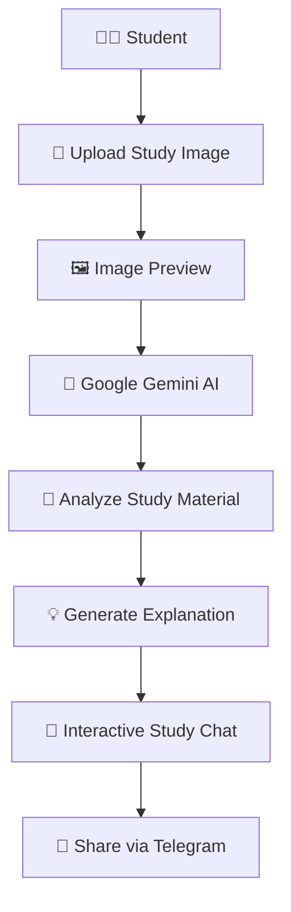

# 📚 Snap & Study

### Your AI-Powered Personal Study Assistant

**Snap. Understand. Learn.**

Snap & Study is an AI-powered learning assistant that helps students understand difficult academic concepts, handwritten notes, questions, and diagrams simply by uploading an image.

Powered by Google's Gemini AI, it analyzes study material and provides easy-to-understand explanations, step-by-step solutions, and interactive follow-up conversations.

Instead of spending hours searching for explanations, simply upload your study material and let AI help you learn.

---

## ✨ Key Features

- **📸 Image-Based Learning:** Upload images of handwritten notes, academic questions, diagrams, and study material.
- **🤖 AI-Powered Explanations:** Uses Google Gemini's multimodal capabilities to understand uploaded images.
- **📖 Simple Explanations:** Converts complex academic concepts into clear, student-friendly language.
- **🧮 Step-by-Step Solutions:** Provides detailed calculations and explanations for numerical problems.
- **💬 Interactive Study Chat:** Ask follow-up questions and continue conversations about your uploaded study material.
- **🧠 Context-Aware Learning:** Maintains conversation context during a study session.
- **🔄 Automatic Model Fallback:** Switches to an alternative Gemini model when temporary service or rate-limit errors occur.
- **📲 Telegram Integration:** Send study explanations and summaries directly to Telegram.
- **⚙️ Model Selection:** Choose between supported Gemini models according to your requirements.
- **👨‍🎓 Student Onboarding:** Configure your student name and Telegram chat ID.

---

## 🚀 How It Works



1. Complete student onboarding.
2. Upload an image containing a question, diagram, or notes.
3. Let Gemini analyze the uploaded material.
4. Receive a simple and structured explanation.
5. Ask follow-up questions through Study Chat.
6. Send your explanation to Telegram.

---

## 🛠️ Technology Stack

| Technology | Purpose |
|---|---|
| Python | Core programming language |
| Streamlit | Interactive web application |
| Google Gemini API | Multimodal AI and image understanding |
| Google Gen AI SDK | Gemini API integration |
| Requests | Telegram Bot API integration |
| Pillow | Image processing support |
| Streamlit Session State | Managing temporary application and chat state |
| Git & GitHub | Version control |

---

## 📂 Project Structure

```text
SnapAndStudy/
│
├── app.py
│   └── Main Streamlit application
│
├── prompts.py
│   └── AI system instructions and prompt configuration
│
├── requirements.txt
│   └── Python dependencies
│
├── secrets.toml.example
│   └── Example API configuration
│
├── .gitignore
│   └── Excluded files and sensitive credentials
│
└── README.md
    └── Project documentation
```

---

## ⚡ Getting Started

Follow these instructions to run Snap & Study locally.

### Prerequisites

Make sure you have installed:

- Python 3.9 or later
- pip (Python package manager)
- Git
- Google Gemini API key
- Telegram account (for Telegram integration)

### 1. Clone the Repository

```bash
git clone https://github.com/arabiyaniuzair/SnapAndStudy.git
```

### 2. Navigate to the Project Directory

```bash
cd SnapAndStudy
```

### 3. Create a Virtual Environment

**Windows:**

```bash
python -m venv venv
venv\Scripts\activate
```

**Linux / macOS:**

```bash
python3 -m venv venv
source venv/bin/activate
```

### 4. Install Dependencies

```bash
pip install -r requirements.txt
```

### 5. Configure API Credentials

Create a `.streamlit` directory in the project root and create a file named `secrets.toml` inside it.

```text
.streamlit/
└── secrets.toml
```

Add your credentials:

```toml
GEMINI_API_KEY = "your_gemini_api_key"
TELEGRAM_BOT_TOKEN = "your_telegram_bot_token"
```

**Get your Gemini API key:**

Visit [Google AI Studio](https://aistudio.google.com/app/apikey) and generate an API key.

**Configure Telegram Bot:**

1. Open Telegram.
2. Search for [@BotFather](https://t.me/BotFather).
3. Create a new bot using `/newbot`.
4. Copy the generated bot token.
5. Add it to your `secrets.toml` file.

To receive messages, users must first start the Telegram bot and provide their own Telegram chat ID.

> **Security:** Never upload your `secrets.toml` file, API keys, or bot tokens to GitHub. Keep credentials private.

### 6. Run the Application

```bash
streamlit run app.py
```

Open your browser and visit:

```text
http://localhost:8501
```

---

## 📖 Application Navigation

| Section | Description |
|---|---|
| Home | Welcome page and application introduction |
| Onboarding | Configure student information and Telegram details |
| Study Chat | Upload study images and interact with Gemini AI |
| About | Learn more about Snap & Study |

---

## 🤖 Supported AI Models

Snap & Study provides model selection through the application sidebar.

| Model | Description |
|---|---|
| Gemini 3.5 Flash-Lite | Recommended for faster responses |
| Gemini 3.8 Flash | Alternative model option |
| Gemini 3.5 Flash | Balanced model option |

The application also includes automatic fallback handling for selected temporary service errors and rate limits.

*Model availability, API limits, and pricing depend on Google's current Gemini API offering.*

---

## 📲 Telegram Integration

Snap & Study integrates with the Telegram Bot API to make sharing study explanations easier.

Students can connect their Telegram account and receive generated explanations directly through Telegram.

**Telegram Bot:** [@SnapAndStudyLearningBot](https://t.me/SnapAndStudyLearningBot)

---

## 🔐 Security & Privacy

- API credentials are configured separately from application source code.
- Sensitive configuration files should be excluded from version control.
- Telegram communication uses the official Telegram Bot API.
- Student and conversation information is maintained using Streamlit session state.

**Note:** The current application does not provide permanent database-backed storage. Session data may be lost when the session ends or resets.

---

## 🔮 Future Improvements

Potential enhancements for future versions include:

- [ ] PDF and document upload support.
- [ ] AI-generated flashcards and practice quizzes.
- [ ] Subject-wise organization of study material.
- [ ] Multilingual explanations.
- [ ] Persistent student profiles and learning history.
- [ ] Downloadable study notes in PDF format.
- [ ] Improved conversation management.
- [ ] Additional AI model providers and fallback options.
- [ ] Personalized learning recommendations.

---

## 🤝 Contributing

Contributions, suggestions, bug reports, and feature requests are welcome!

1. Fork this repository.
2. Create a new feature branch.

```bash
git checkout -b feature/your-feature-name
```

3. Commit your changes.

```bash
git commit -m "Add: your feature description"
```

4. Push your branch.

```bash
git push origin feature/your-feature-name
```

5. Open a Pull Request.

---

## 📄 License

This project is available under the license specified in the repository. Please check the `LICENSE` file for details.

---

## 👨‍💻 Author

**Uzair Arabiyani**

GitHub: [@arabiyaniuzair](https://github.com/arabiyaniuzair)

---

<p align="center">
  <b>📚 Snap & Study</b><br>
  <i>Snap. Understand. Learn.</i><br><br>
  Built with ❤️ using Python, Streamlit and Google Gemini AI.
</p>
